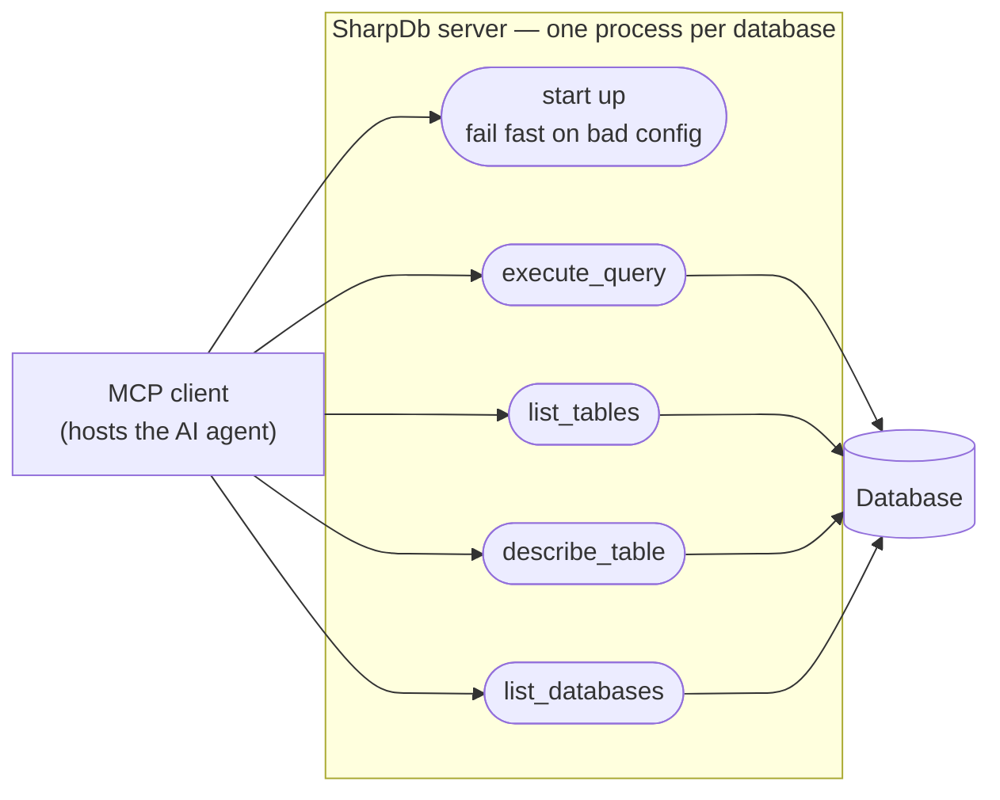

# SharpDb use cases

Who uses SharpDb, and what they do with it.

## Actors

**MCP client** — the application that hosts the AI agent. It launches the server as a child process and invokes the four tools. It is the only runtime actor.

**Database** — a supporting actor: an external system the server reads from, never writes to.

## Use cases

| Use case | What it does | Why it is not obvious |
|---|---|---|
| Start up, fail fast on bad config | Reads its configuration and opens one connection to prove the database is reachable. Any failure ends the process with a non-zero code and a single line on stderr. | The alternative — starting anyway and failing per call — hides the real problem. A process that exits is a problem the client can report. |
| `execute_query` | Runs one read-only SQL statement through the Guard and returns a result set. | The only use case a user's own text reaches. Everything read-only is enforced here. |
| `list_tables` | Lists the tables and views in the connected database. | Establishes what the agent may ask about. |
| `describe_table` | Describes one table: columns, primary key, foreign keys, indexes. | Lets the agent write correct queries instead of guessing at column names. |
| `list_databases` | Lists the databases visible to the connection. | Informational only. The server is bound to one database and other tools cannot reach the others. |

## Who is deliberately absent

**The human.** A person installs the tool and writes the client's configuration, but at runtime the client is the only thing the server talks to. There is no prompt, no confirmation, no interactive surface. Adding a human actor would imply an interaction the system does not have.

This is what makes the read-only decision ([ADR 0001](../docs/adr/0001-read-only-v1.md)) load-bearing: with no human in the loop, there is no one to approve a write, so the server must be incapable of one.

## A note on vocabulary

**MCP client** is used here, not *MCP host*, because **Host** is already a defined term in [GLOSSARY.md](../GLOSSARY.md) meaning this project's own assembly layer — the executable that wires Core and the Provider together. The MCP protocol's *host* is a different thing: the client-side application. Two meanings, one word; this file keeps them apart.
